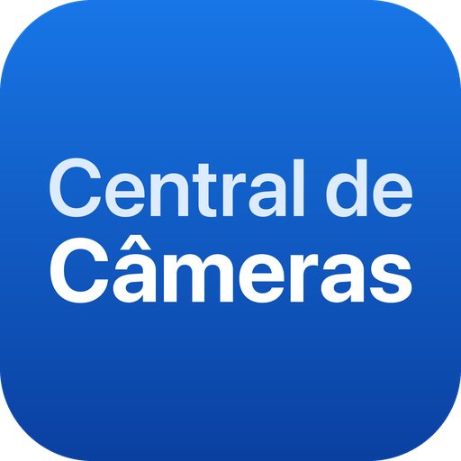
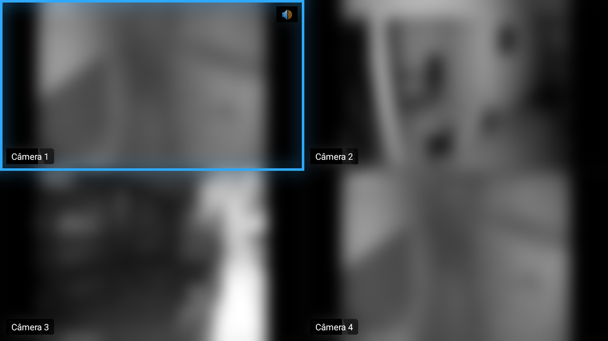
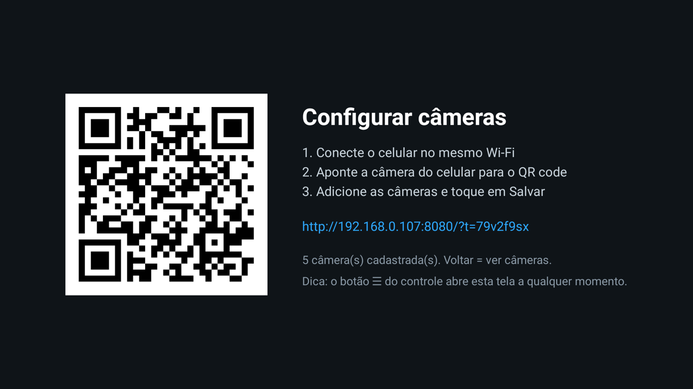
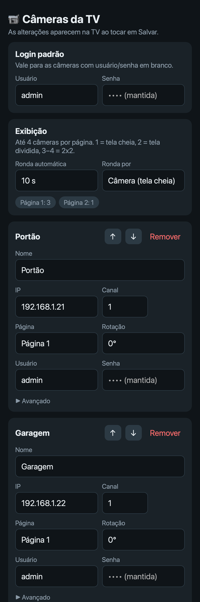
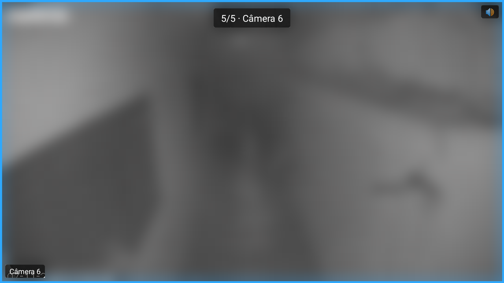

# cam-firestick

**English** · [Português](README.pt-BR.md)

Turn a Fire TV Stick into a live security-camera wall. A lightweight native Android TV app that plays RTSP camera streams in a paged grid, follows the remote's focus with audio, and is configured from your phone by scanning a QR code.

<p align="center">
  
</p>

> Camera footage in the screenshots is intentionally blurred.

> ⚠️ **Disclaimer:** this is a personal hobby project, provided **as is, without warranty of any kind**. Use it at your own risk. The author is **not responsible** for any damage, data loss, security issue or malfunction caused by installing or using this app.
>
> It has **only been tested on a Fire TV Stick HD** (model AFTSS, Fire OS 7), **installed via sideload**. Other devices may behave differently or may not work at all.

## Download and install

1. Download the latest `cam-firestick-vX.Y.Z.apk` from the [Releases](https://github.com/FilipFelipe/cam-firestick/releases) page. Each release lists a SHA-256 checksum you can use to verify the file.
2. Install it on the Fire TV with **one** of these options.

**Option A: Downloader app (no computer needed)**
1. On the Fire TV, install **Downloader** (by AFTVnews) from the Amazon Appstore.
2. Go to *Settings → My Fire TV → Developer options → Install unknown apps* and turn **Downloader** on. If that menu doesn't appear, open *My Fire TV → About* and select the device name 7 times to unlock *Developer options*.
3. Open Downloader, type the APK link from the Releases page and install it.

**Option B: ADB from a computer.** See [Install on a Fire TV](#install-on-a-fire-tv) below.

After installing, open **Central de Câmeras**. It shows a QR code: scan it with your phone, which must be on the same Wi-Fi, and add your cameras.

## Features

- **Paged grid**: up to 4 live cameras per page, which is the hardware decoder limit of the Fire TV Stick HD. The layout adapts to how many cameras a page has:
  - 1 camera fills the screen.
  - 2 cameras split the screen in half.
  - 3 or 4 cameras use a 2x2 grid.
- **Audio follows focus**: only the focused camera plays sound (🔊).
- **Fullscreen**: press OK to open a camera in fullscreen. It switches to the high-quality main stream, and the other cameras go to standby to free their decoders and network connections.
- **Tour mode**: cycles automatically every N seconds, either page by page or camera by camera (in fullscreen).
- **Phone setup via QR code**: the TV shows a QR code, and your phone opens a setup page served by the Fire TV itself. No cloud, no app to install, and no typing with the remote.
  - Scan the network for RTSP cameras.
  - Set a default login.
  - Assign each camera to a page, set its order and rotate it (0°/90°/180°/270°).
- **Auto-reconnect**: RTSP runs over TCP with a small buffer for low latency, and a dropped stream retries every 3 seconds.

<p align="center">
  
  &nbsp;
  
</p>

<p align="center">
  
</p>

## Remote control

| Button | Grid | Fullscreen |
|---|---|---|
| D-pad | Move focus (audio follows) | ← / → previous / next camera |
| ← / → at the edge, ⏪ / ⏩ | Previous / next page | Previous / next camera |
| OK | Open fullscreen | Back to grid |
| Back | Exit app | Back to grid |
| ☰ Menu | Open QR setup | Open QR setup |

## Camera compatibility

By default the app builds Dahua/Intelbras-style URLs:

```
rtsp://user:pass@<ip>:554/cam/realmonitor?channel=<n>&subtype=<0|1>
```

- **Streams**: the grid uses the sub stream (`subtype=1`), and fullscreen uses the main stream (`subtype=0`). Enable the sub stream on your cameras, ideally H.264 at around 640x480.
- **Other brands**: paste the full RTSP URL under *Advanced* on the setup page.
- **Audio**: AAC works best. If a camera has no sound, switch its audio codec to AAC.

## Build from source

Requires JDK 17–21 and the Android SDK (both ship with Android Studio).

```sh
export JAVA_HOME=/path/to/jdk-21          # e.g. Android Studio's bundled JBR
echo "sdk.dir=$HOME/Library/Android/sdk" > local.properties
./gradlew assembleDebug
```

The APK is written to `app/build/outputs/apk/debug/app-debug.apk`.

## Install on a Fire TV

1. On the Fire TV, go to *Settings → My Fire TV → Developer options* and turn on **ADB debugging**.
2. Find its IP address under *My Fire TV → About → Network*.
3. Install from your computer:

   ```sh
   adb connect <FIRE_TV_IP>:5555      # accept the prompt on the TV
   adb install -r app/build/outputs/apk/debug/app-debug.apk
   ```

## How it works

| File | Role |
|---|---|
| `MainActivity.kt` | Grid pages, fullscreen, remote keys, tour |
| `CameraTile.kt` | One player (Media3 ExoPlayer + RTSP), reconnect, rotation |
| `Camera.kt` | Camera model and local storage |
| `SetupActivity.kt` | QR code screen; runs the setup server while it is open |
| `ConfigServer.kt` | Embedded HTTP server (NanoHTTPD) and JSON API |
| `assets/setup.html` | Phone setup page (vanilla HTML/JS) |

## Privacy and security

- Camera credentials are stored only on the Fire TV, in app-private storage. The setup page never receives saved passwords back.
- The setup server runs only while the QR screen is open, listens on your LAN, and requires a random token that is embedded in the QR code.
- No analytics and no cloud: video goes straight from your cameras to the TV.

## Known limitations

- **Decoder limit**: the Fire TV Stick HD can decode only 4 video streams at once. The limit is hardcoded for now and may differ on other models.
- **Vega OS**: newer Fire TV devices that run Vega OS instead of Android-based Fire OS cannot run this app.
