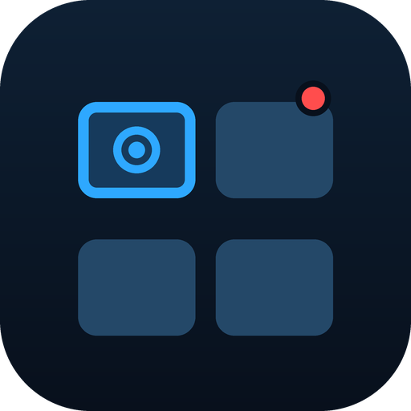
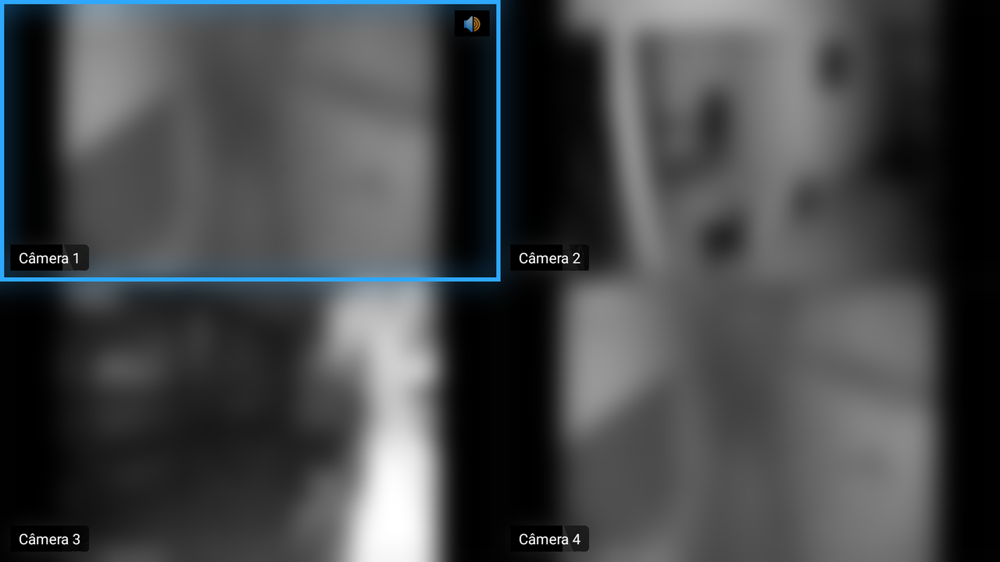
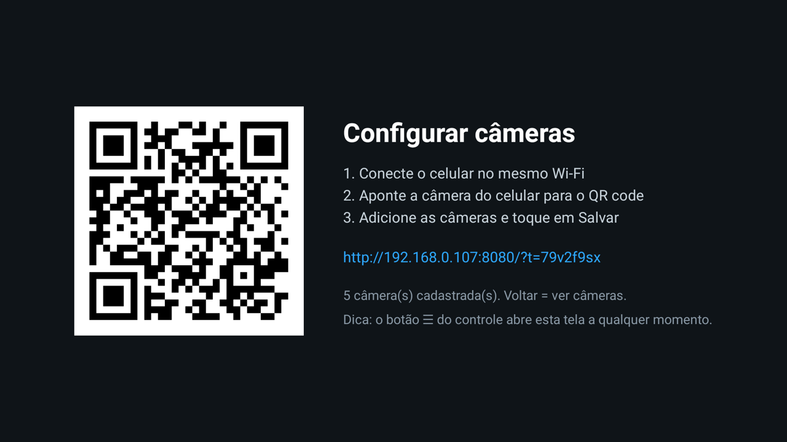
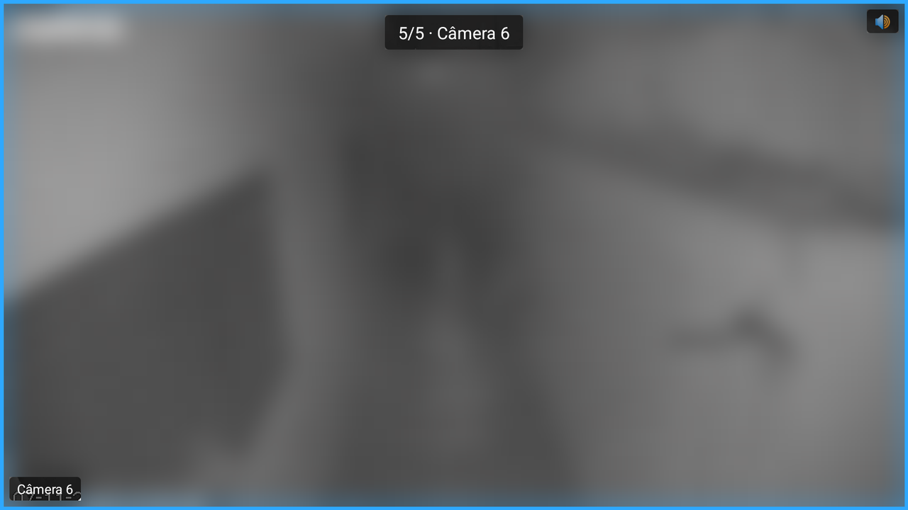
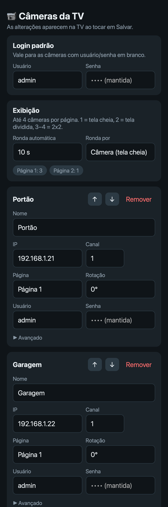

# cam-firestick

[English](README.md) · **Português**

Transforma um Fire TV Stick numa central de monitoramento de câmeras. É um app Android TV nativo e leve que mostra câmeras RTSP ao vivo num mosaico em páginas. O áudio segue o foco do controle, e a configuração é feita pelo celular, lendo um QR code.

<p align="center">
  
</p>

> As imagens das câmeras nos prints estão borradas de propósito.

> ⚠️ **Aviso:** este é um projeto pessoal, fornecido **como está, sem nenhuma garantia**. O uso é por sua conta e risco. O autor **não se responsabiliza** por qualquer dano, perda de dados, problema de segurança ou mau funcionamento causado pela instalação ou pelo uso deste app.
>
> Ele **só foi testado num Fire TV Stick HD** (modelo AFTSS, Fire OS 7), **instalado via sideload**. Outros aparelhos podem se comportar de outro jeito ou nem funcionar.

## Baixar e instalar

1. Baixe o `cam-firestick-vX.Y.Z.apk` mais recente na página de [Releases](https://github.com/FilipFelipe/cam-firestick/releases). Cada versão traz o hash SHA-256 para você conferir o arquivo.
2. Instale no Fire TV de **uma** destas formas.

**Opção A: app Downloader (sem computador)**
1. No Fire TV, instale o **Downloader** (da AFTVnews) pela Appstore da Amazon.
2. Vá em *Configurações → Minha Fire TV → Opções do desenvolvedor → Instalar apps desconhecidos* e ative o **Downloader**. Se esse menu não aparecer, abra *Minha Fire TV → Sobre* e selecione o nome do aparelho 7 vezes para liberar as *Opções do desenvolvedor*.
3. Abra o Downloader, digite o link do APK que está na página de Releases e instale.

**Opção B: ADB pelo computador.** Veja [Instalar no Fire TV](#instalar-no-fire-tv) mais abaixo.

Depois de instalar, abra o **Central de Câmeras**. Ele mostra um QR code: leia com o celular, que precisa estar no mesmo Wi-Fi, e adicione as suas câmeras.

## Funcionalidades

- **Mosaico em páginas**: até 4 câmeras ao vivo por página, que é o limite de decodificadores do Fire TV Stick HD. O layout se adapta à quantidade de câmeras da página:
  - 1 câmera ocupa a tela inteira.
  - 2 câmeras dividem a tela ao meio.
  - 3 ou 4 câmeras ficam em 2x2.
- **Áudio segue o foco**: só a câmera focada toca som (🔊).
- **Tela cheia**: o OK abre a câmera em tela cheia. Ela passa para o stream principal, de alta qualidade, e as outras câmeras entram em standby para liberar decodificadores e conexões de rede.
- **Ronda**: troca automaticamente a cada N segundos, por página ou por câmera (em tela cheia).
- **Configuração pelo celular via QR code**: a TV mostra um QR, e o celular abre uma página servida pelo próprio Fire TV. Sem nuvem, sem instalar app e sem digitar no controle.
  - Procura câmeras RTSP na rede.
  - Define um login padrão.
  - Coloca cada câmera numa página, define a ordem e gira a imagem (0°/90°/180°/270°).
- **Reconexão automática**: o RTSP vai por TCP com buffer curto para ter pouco atraso, e um stream que cai tenta de novo a cada 3 segundos.

<table>
  <tr>
    <th>TV: QR code e tela cheia</th>
    <th>Celular: página de configuração</th>
  </tr>
  <tr>
    <td width="72%" valign="top">
      
      <br><br>
      
    </td>
    <td width="28%" valign="top">
      
    </td>
  </tr>
</table>

## Controle remoto

| Botão | Mosaico | Tela cheia |
|---|---|---|
| D-pad | Move o foco (o áudio acompanha) | ← / → câmera anterior / próxima |
| ← / → na borda, ⏪ / ⏩ | Página anterior / próxima | Câmera anterior / próxima |
| OK | Abre em tela cheia | Volta ao mosaico |
| Voltar | Sai do app | Volta ao mosaico |
| ☰ Menu | Abre a configuração (QR) | Abre a configuração (QR) |

## Compatibilidade

Por padrão o app monta URLs no formato Dahua/Intelbras:

```
rtsp://usuario:senha@<ip>:554/cam/realmonitor?channel=<n>&subtype=<0|1>
```

- **Streams**: o mosaico usa o substream (`subtype=1`), e a tela cheia usa o stream principal (`subtype=0`). Deixe o substream ativo nas câmeras, de preferência em H.264 com uns 640x480.
- **Outras marcas**: cole a URL RTSP completa em *Avançado*, na página de configuração.
- **Áudio**: AAC é o que funciona melhor. Se uma câmera ficar sem som, mude o codec de áudio dela para AAC.

## Compilar o código

Precisa do JDK 17 a 21 e do Android SDK (os dois vêm com o Android Studio).

```sh
export JAVA_HOME=/caminho/para/jdk-21     # ex.: o JBR que vem com o Android Studio
echo "sdk.dir=$HOME/Library/Android/sdk" > local.properties
./gradlew assembleDebug
```

O APK sai em `app/build/outputs/apk/debug/app-debug.apk`.

## Instalar no Fire TV

1. No Fire TV, vá em *Configurações → Minha Fire TV → Opções do desenvolvedor* e ative a **Depuração ADB**.
2. Veja o IP em *Minha Fire TV → Sobre → Rede*.
3. Instale a partir do computador:

   ```sh
   adb connect <IP_DO_FIRE_TV>:5555   # aceite o pedido na TV
   adb install -r app/build/outputs/apk/debug/app-debug.apk
   ```

## Lançar uma versão

As versões são compiladas e publicadas pelo GitHub Actions (`.github/workflows/release.yml`):

```sh
git tag v0.2.0
git push origin v0.2.0
```

- **Versão**: o workflow pega da tag (`v0.2.0` vira o versionName `0.2.0` e o versionCode `200`).
- **Assinatura**: ele assina o APK com a chave de release guardada nos secrets do repositório: `KEYSTORE_BASE64`, `KEYSTORE_PASSWORD`, `KEY_ALIAS` e `KEY_PASSWORD`.
- **Notas da versão**: ele usa `docs/release-notes/<tag>.md` se o arquivo existir e acrescenta o SHA-256.

## Como funciona

| Arquivo | Função |
|---|---|
| `MainActivity.kt` | Páginas do mosaico, tela cheia, teclas do controle, ronda |
| `CameraTile.kt` | Um player (Media3 ExoPlayer + RTSP), reconexão, rotação |
| `Camera.kt` | Modelo da câmera e armazenamento local |
| `SetupActivity.kt` | Tela do QR code; roda o servidor de configuração enquanto está aberta |
| `ConfigServer.kt` | Servidor HTTP embutido (NanoHTTPD) e API JSON |
| `assets/setup.html` | Página de configuração do celular (HTML/JS puro) |

## Privacidade e segurança

- As senhas das câmeras ficam só no Fire TV, no armazenamento privado do app. A página do celular nunca recebe de volta as senhas salvas.
- O servidor de configuração só roda enquanto a tela do QR está aberta, escuta só na rede local e exige um token aleatório que vai dentro do QR.
- Sem analytics e sem nuvem: o vídeo vai direto das câmeras para a TV.

## Limitações conhecidas

- **Limite de decodificadores**: o Fire TV Stick HD só decodifica 4 vídeos ao mesmo tempo. Por enquanto o limite está fixo no código e pode ser diferente em outros modelos.
- **Vega OS**: os Fire TV mais novos que usam o Vega OS em vez do Fire OS (baseado em Android) não rodam este app.
